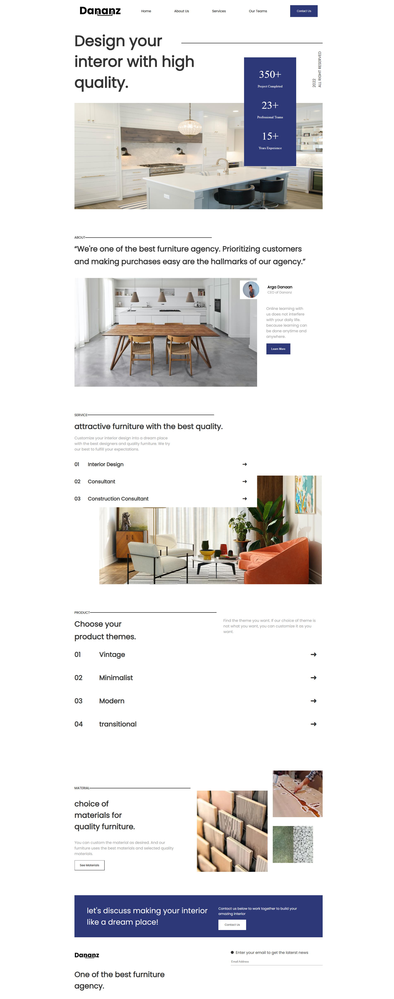
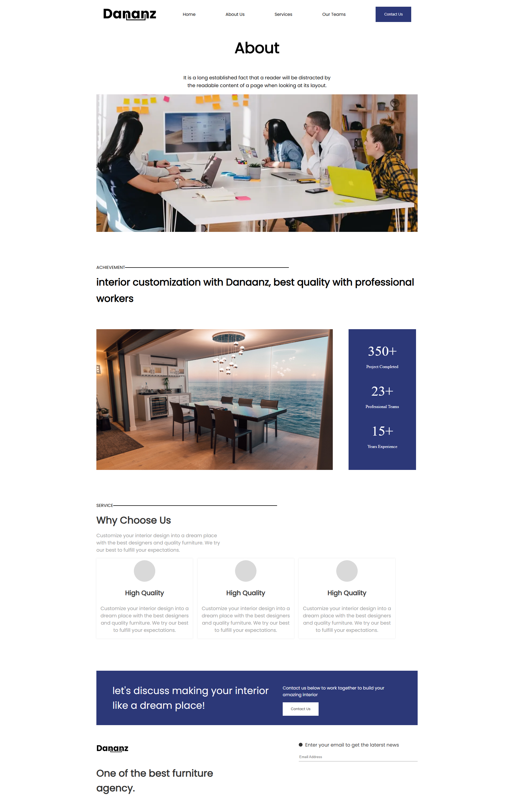
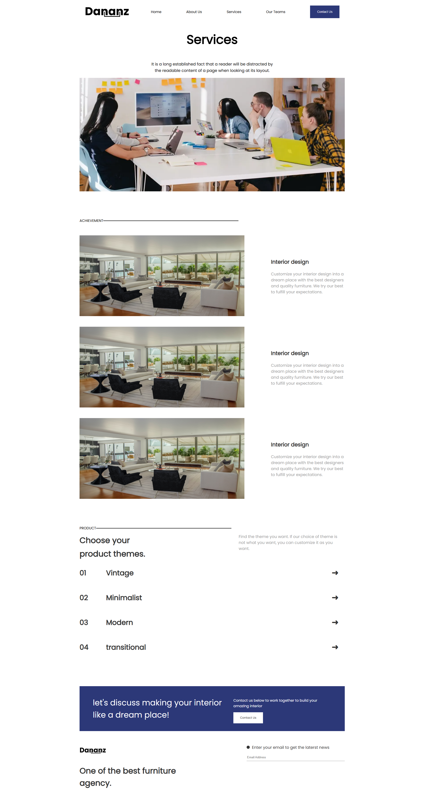
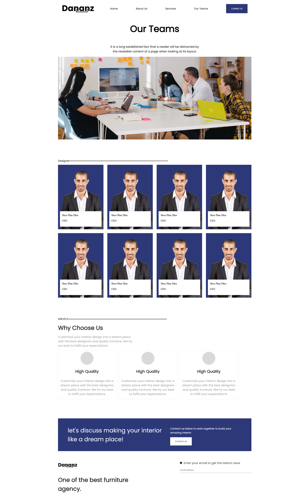

# Dananz — дизайн интерьера

Многостраничный сайт дизайн-студии Dananz. На сайте представлены интерьерные проекты, услуги, направления дизайна и команда специалистов.

## Скриншоты

### Главная страница



### О студии



### Услуги



### Команда



## Страницы сайта

- `/` — главная: информация о студии, услугах, коллекциях и материалах.
- `/AboutUs` — о студии и её достижениях.
- `/Services` — услуги и направления работы.
- `/OurTeam` — команда и дизайнеры.

## Технологии

- React
- React Router
- Vite
- AOS для анимации при прокрутке
- ESLint

## Запуск проекта

Требуется установленный Node.js и npm.

```bash
npm install
npm run dev
```

После запуска Vite выведет адрес локального сервера в терминал.

## Команды

```bash
npm run dev      # Запустить сервер разработки
npm run build    # Собрать production-версию в dist/
npm run preview  # Просмотреть production-сборку
npm run lint     # Проверить код с ESLint
```
